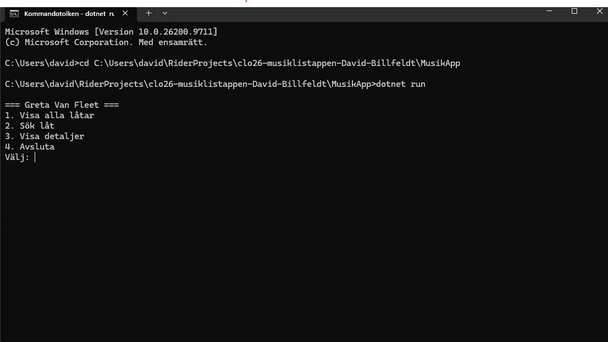

# Musiklistappen — [David Billfeldt]

---

## Vad appen gör

[Min app handlar om mitt favorit band Greta Van Fleet. Appen kan visa alla låtar som databasen har, man kan söka efter en spcifik låt. Man kan få upp all tillgänglig information om specifika låtar.]

## Så kör du den

```bash
git clone [https://github.com/davidbillfeldt-bot/clo26-musiklistappen-David-Billfeldt.git]
cd C:\Users\david\RiderProjects\clo26-musiklistappen-David-Billfeldt\MusikApp
dotnet run
```

[Databasen `musik.db` ligger redan i mappen `MusikApp/` och följer med i repot, så inget extra behöver göras. Kräver .NET 10 SDK.

Alternativt: öppna `MusikApp.slnx` i Rider eller Visual Studio och tryck ▶ Run.]

## Så ser huvudmenyn ut

[]

--- Går ej för VG denna uppgift!

## Mina designval (VG)

*Fyll i det här avsnittet om du siktar på VG. Annars kan du ta bort det.*

1. **Hur designade du din databas? Varför valde du just den strukturen?**

   [Skriv här]

2. **Vilket SQL-krav valde du (JOIN eller subquery) och varför passade det din app?**

   [Skriv här]

3. **Vad skulle du gjort annorlunda om du byggde om den från scratch?**

   [Skriv här]
